  

Oi, sou o Hugo. Moro em Ji-Paraná, Rondônia, e trabalho na Uni Internet, um provedor de internet daqui.

Lá eu cuido do ERP que a empresa usa no dia a dia: contrato, ordem de serviço, estoque e o app que o técnico leva para a rua. O front é Next.js e o back é Go com gRPC. Quase tudo isso fica em repositório privado, então o gráfico de contribuições lá embaixo conta mais do que a lista de repositórios.

## Coisas que dá para abrir e ver

**[Almofadada](https://github.com/hugh514/minijogos-de-sofa)**
Party game 3D que roda no PC e usa o celular de cada pessoa como controle, pelo Wi-Fi de casa. Ninguém instala nada no celular e não precisa de internet. De 2 a 4 jogadores, 80 minijogos, servidor Node sem dependência e three.js na TV.
Começou porque a minha irmã queria jogar alguma coisa comigo e não sabia o quê. Aí eu vi um cara que tinha feito um jogo na web com o celular de controle e resolvi fazer o nosso.

**[Silvania's Cacau](https://silvanias-site.vercel.app)**
Vitrine de uma agroindústria de chocolate artesanal da Amazônia, que antes só divulgava pelo Instagram. Catálogo com contato pelo WhatsApp e um painel para a própria empresa cadastrar os produtos. Next.js com Supabase.

**[agentes-padrao](https://github.com/hugh514/agentes-padrao)**
As regras que eu uso para trabalhar com Claude Code e Codex sem que eles digam "pronto" antes de rodar o teste. Tem skills, um hook que cobra revisão e Playwright no fim de cada turno e um checklist de segurança. Em português.

**[Plataforma de barbearia](https://github.com/hugh514/api-barbearia)**
API multi-tenant em NestJS com fila por ordem de chegada, check-in por QR Code, assinatura e PIX pelo Mercado Pago, mais o [painel da barbearia](https://github.com/hugh514/barbearia-backoffice) e o [app do cliente](https://github.com/hugh514/barbearia-cliente) em Next.js.

## O que eu uso

TypeScript na maior parte do tempo: React e Next.js no front, NestJS no back. Go quando o serviço precisa aguentar carga gastando pouco. PostgreSQL e Redis em quase tudo, Docker e GitHub Actions para colocar no ar e Playwright para não ter surpresa na tela. App mobile eu faço com React Native e Expo.

  

 

  <a href="https://www.linkedin.com/in/hugo-santos-875bb2245/">LinkedIn</a>
  &nbsp;·&nbsp;
  <a href="mailto:santos.hugh514@gmail.com">santos.hugh514@gmail.com</a>

