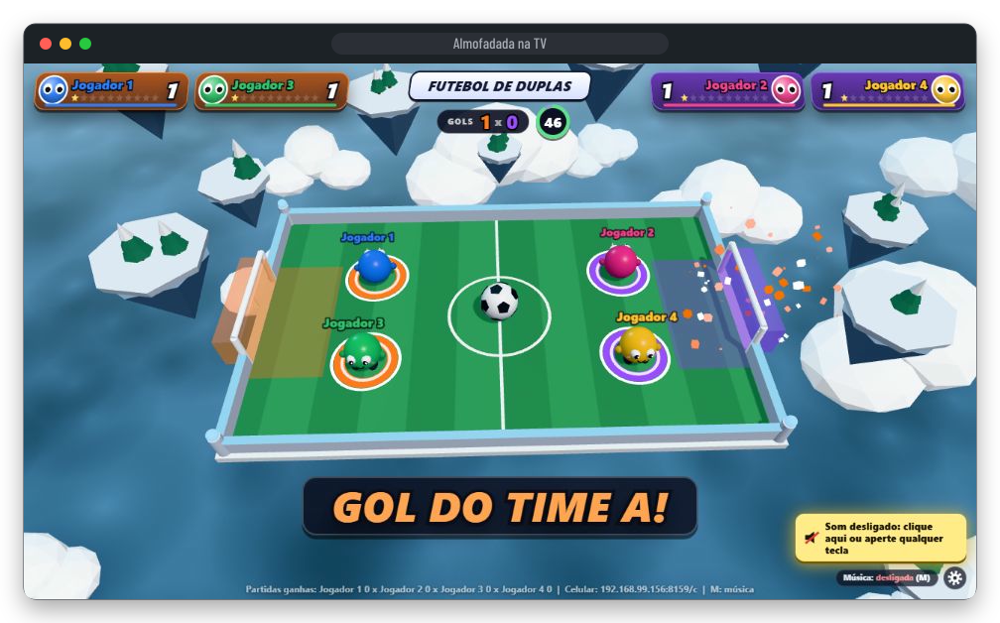

<samp>
<a href="https://www.linkedin.com/in/hugo-santos-875bb2245/">linkedin</a> · <a href="mailto:santos.hugh514@gmail.com">e-mail</a> · ji-paraná, rondônia
</samp>

**Hugo Santos.** Técnico em informática formado pelo IFRO, trabalho com desenvolvimento aqui em Ji-Paraná, hoje na Uni Internet.

Meu dia a dia é TypeScript de ponta a ponta: telas em React e Next.js, APIs em Node.js e NestJS. Quando um serviço precisa aguentar mais carga, escrevo em Go. O que mais gosto é pegar um problema real de alguém e transformar em algo que a pessoa usa todo dia.

#### coisas que fiz

- [almofadada](https://github.com/hugh514/minijogos-de-sofa): minha irmã queria jogar alguma coisa comigo e não sabia o quê, então fiz um jogo para a gente. Abre no PC, aparece na TV e cada um usa o próprio celular como controle. [Baixar para Windows](https://github.com/hugh514/minijogos-de-sofa/releases/latest). javascript, three.js
- [silvania's cacau](https://silvanias-site.vercel.app): site que ajudamos a fazer para uma chocolateria daqui da região, com catálogo e pedido pelo WhatsApp. next.js
- [barbearia](https://github.com/hugh514/api-barbearia): sistema para barbearia que estou construindo aos poucos, com fila do dia, check-in e planos. Ainda em andamento. nestjs, prisma

#### no dia a dia

<samp>typescript · react · next.js · node.js · nestjs · go · postgresql · redis · docker</samp>
