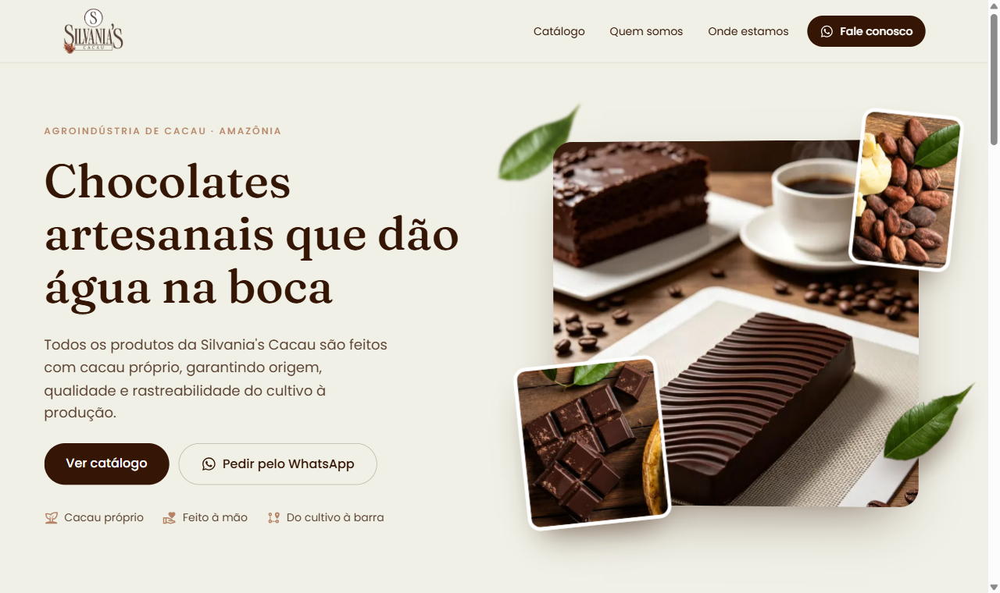

  

  Oi, sou o Hugo. Na Uni Internet, um provedor de internet daqui, cuido de vários sistemas internos. 
  Fora do trabalho, faço coisas para gente que eu conheço. 
  Se quiser conversar, me chama no <a href="https://www.linkedin.com/in/hugo-santos-875bb2245/">LinkedIn</a> ou por <a href="mailto:santos.hugh514@gmail.com">e-mail</a>.

 

## Almofadada

<table>
  <tr>
    <td width="58%" valign="top">
      
Minha irmã queria jogar alguma coisa comigo e não sabia o quê. Aí eu vi um cara que tinha feito um jogo na web com o celular de controle e resolvi fazer o nosso.

      
O jogo roda no PC e aparece na TV. Cada pessoa abre uma página no celular, que vira joystick, pelo Wi-Fi de casa. Não precisa instalar nada no celular nem ter internet. São 80 minijogos para 2 a 4 pessoas.

      
Feito com three.js e um servidor Node que conversa com os celulares por WebSocket. Dá para <a href="https://github.com/hugh514/minijogos-de-sofa/releases/latest">baixar para Windows</a> e jogar, ou ver o <a href="https://github.com/hugh514/minijogos-de-sofa">código</a>.

    </td>
    <td width="42%" valign="middle">
      
    </td>
  </tr>
</table>

 

## Outros projetos

<table>
  <tr>
    <td width="50%" valign="top">
      
      <h3><a href="https://silvanias-site.vercel.app">Silvania's Cacau</a></h3>
      
Uma agroindústria de chocolate artesanal da Amazônia que só divulgava pelo Instagram. Agora tem catálogo, pedido pelo WhatsApp e um painel para cadastrar os próprios produtos. Next.js com Supabase por trás.

    </td>
    <td width="50%" valign="top">
      <h3><a href="https://github.com/hugh514/api-barbearia">Plataforma de barbearia</a></h3>
      
Fila por ordem de chegada, check-in por QR Code, assinatura mensal e PIX. Uma API atende várias barbearias, com o <a href="https://github.com/hugh514/barbearia-backoffice">painel</a> e o <a href="https://github.com/hugh514/barbearia-cliente">app do cliente</a> em cima dela.

      
A API é NestJS com PostgreSQL, e as filas de mensagem e pagamento rodam no BullMQ.

      <h3><a href="https://github.com/hugh514/agentes-padrao">agentes-padrao</a></h3>
      
As regras que eu uso para trabalhar com agentes de código sem que eles digam "pronto" antes de rodar o teste. Tem um hook que cobra revisão e Playwright no fim de cada turno.

    </td>
  </tr>
</table>

 

## No dia a dia

Escrevo TypeScript quase o tempo todo: React e Next.js no front, NestJS no back. Uso Go quando o serviço precisa aguentar carga gastando pouco. PostgreSQL e Redis entram em quase tudo, Docker e GitHub Actions colocam no ar e Playwright garante que a tela não quebrou. Para celular, React Native com Expo.

 

  

