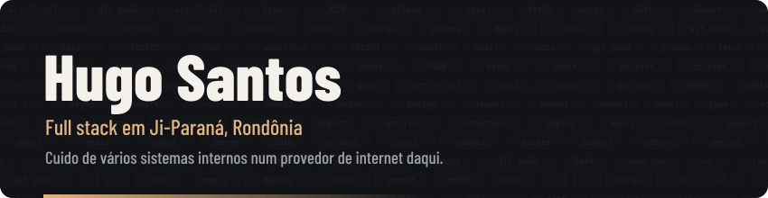
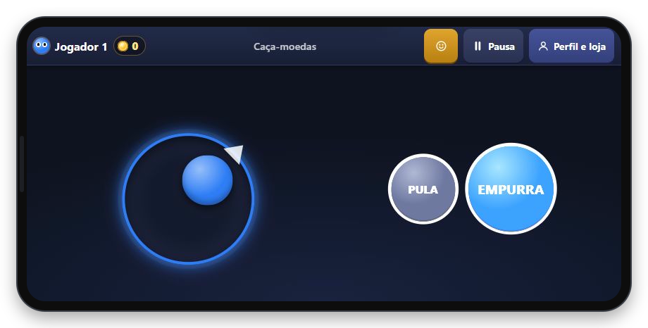
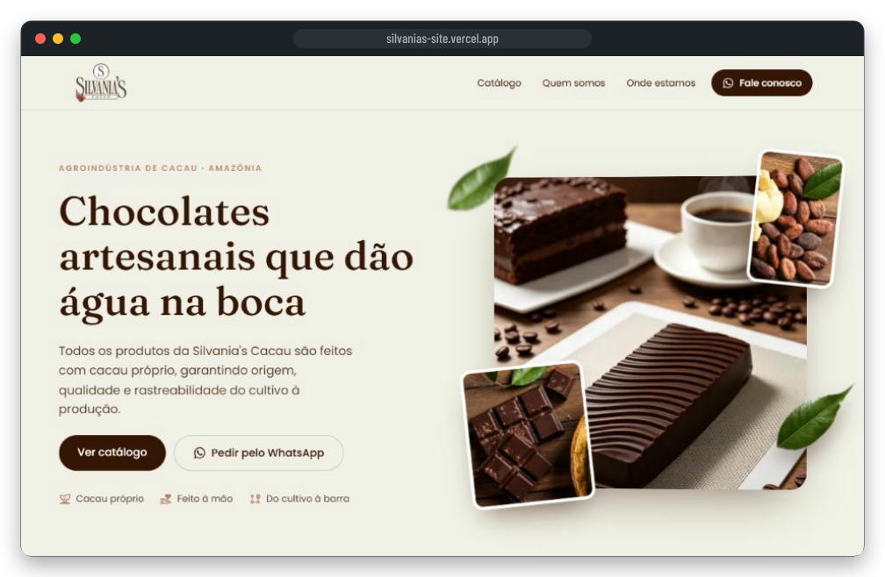
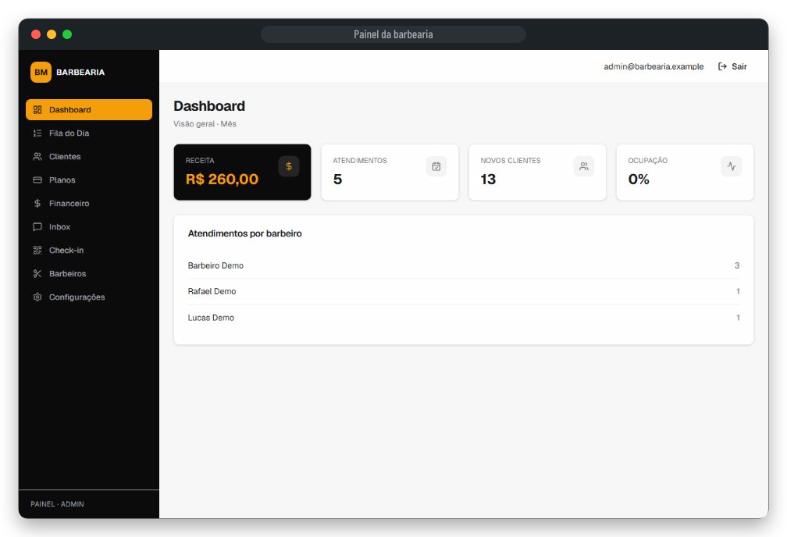

  

 

Fora do trabalho, faço coisas para gente que eu conheço: um jogo para jogar com a minha irmã, o site de uma chocolateria daqui da região e um sistema para barbearias.

### Almofadada

<table>
  <tr>
    <td width="60%"></td>
    <td width="40%" valign="middle"></td>
  </tr>
</table>

Minha irmã queria jogar alguma coisa comigo e não sabia o quê. Aí eu vi um cara que tinha feito um jogo na web com o celular de controle e resolvi fazer o nosso. O jogo roda no PC e aparece na TV, e cada pessoa usa o próprio celular como joystick pelo Wi-Fi de casa, sem instalar nada. São 80 minijogos para 2 a 4 pessoas, feitos com three.js e um servidor Node que conversa com os celulares por WebSocket.

[Baixar para Windows](https://github.com/hugh514/minijogos-de-sofa/releases/latest) ou [ver o código](https://github.com/hugh514/minijogos-de-sofa).

### Silvania's Cacau e plataforma de barbearia

<table>
  <tr>
    <td width="50%" valign="top">
      
      
<b><a href="https://silvanias-site.vercel.app">Silvania's Cacau</a></b>. Uma agroindústria de chocolate artesanal da Amazônia que só vendia pelo Instagram. Hoje tem catálogo, pedido pelo WhatsApp e um painel para cadastrar os próprios produtos. Next.js com Supabase.

    </td>
    <td width="50%" valign="top">
      
      
<b><a href="https://github.com/hugh514/api-barbearia">Plataforma de barbearia</a></b>. Fila por ordem de chegada, check-in por QR Code, assinatura mensal e PIX. Uma API em NestJS atende várias barbearias, com o painel da equipe e o app do cliente em Next.js.

    </td>
  </tr>
</table>

### No dia a dia

Escrevo TypeScript quase o tempo todo: React e Next.js no front, NestJS no back. Uso Go quando o serviço precisa aguentar carga gastando pouco. PostgreSQL e Redis entram em quase tudo, Docker e GitHub Actions colocam no ar e Playwright garante que a tela não quebrou. Para celular, React Native com Expo.

  

Me chama no <a href="https://www.linkedin.com/in/hugo-santos-875bb2245/">LinkedIn</a> ou por <a href="mailto:santos.hugh514@gmail.com">e-mail</a>.

